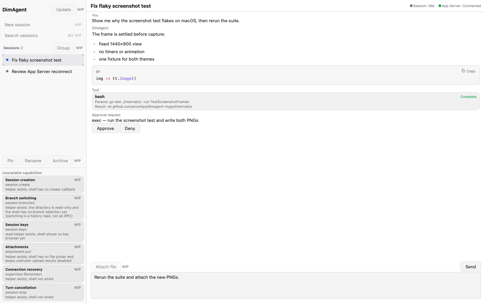
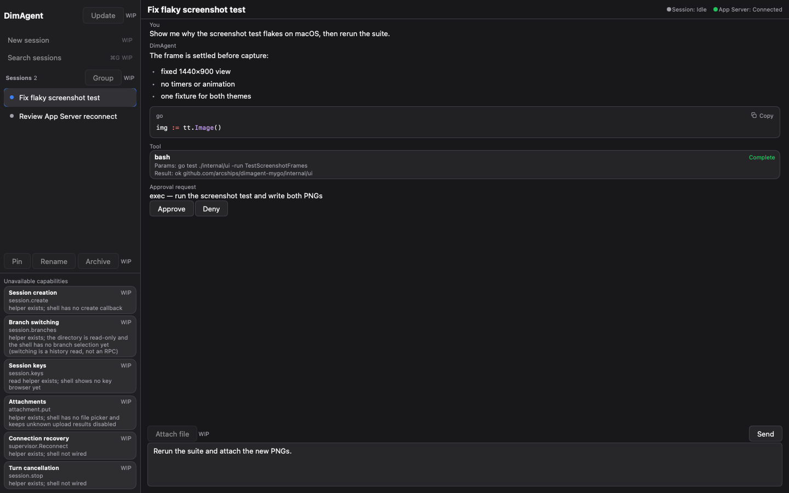

# UI 截图证据（headless）

本目录保存 `internal/ui` 静态壳的 headless 截图，用来证明固定 fixture 在 1440×900 下的渲染是稳定的（两主题、非空、尺寸正确、light/dark 像素不同）。生成代码是 [`internal/ui/screenshot_test.go`](../../../internal/ui/screenshot_test.go)。

## 生成命令

从仓库根目录运行：

```bash
DIMAGENT_UI_SCREENSHOT_DIR="$PWD/docs/evidence/ui" go test ./internal/ui -run TestScreenshotFrames -v
```

- 未设置 `DIMAGENT_UI_SCREENSHOT_DIR` 时，测试只做断言，不写任何文件（`go test ./internal/ui` 保持只读）。
- 设置后写入本目录的 `shell-light.png` 和 `shell-dark.png`，目录不存在会自动创建。
- 截图 API 来自 mygo v0.8.3 模块源码：`ui.NewTester(view, width, height)`、`(*Tester).SetDark(bool)`、`(*Tester).Image() *image.RGBA`。mygo 自带的 `MYGO_UI_PNG` 只服务于该模块自己的 `ui/ui_test.go`，不是公开 API，本项目不读取它。

## 产物

| 文件 | 主题 | 尺寸 | 大小 |
|---|---|---|---|
| [`shell-light.png`](shell-light.png) | Light | 1440×900 | 141,272 B |
| [`shell-dark.png`](shell-dark.png) | Dark | 1440×900 | 144,092 B |





文件大小随字体栅格化和压缩实现变化，不作为断言；测试断言的是尺寸、非空和两主题像素不同。

## 侧栏布局（P0，规格见 [`docs/ui-layout-spec.md`](../../ui-layout-spec.md) §2）

截图里的侧栏按 256 DIP 默认宽绘制，左侧内容与主区之间是可拖的分隔条（MyGo `ui.Split`，`internal/ui/shell.go` 的 `View`）：

| 区域 | 高度 / 宽度 | 数值来源 |
|---|---|---|
| 侧栏宽 | 256（拖拽 200–360） | `docs/ui-layout-spec.md` §1.2；`internal/ui/tokens.go` |
| Header | 48，上边距 4，左右内距 7 | `h-(--titlebar-height)=48px`、`mt-[4px]`、`px-2` |
| 全局入口 | 每条 28 高，间距 3.5，区块内距 7 | `h-8`、`gap-1`、`p-2` |
| 表标题行 | 31.5 高，左右内距 7 | `h-9`、`px-3` |
| 线程行 | 34 高，圆角 8 | `h-[34px]`、`rounded-md`（分组视图） |
| 行内状态格 | 21×21 | `h-6 w-6` |
| 底部署名行（Pin/Rename/Archive） | 最小 30 高 | `h-[30px]`（footer 行高） |

这些 Tailwind 档位都按规格换算成 14px 根字号下的 DIP，而不是照抄 4px 网格。侧栏本身是唯一滚动区（`ui.List`），底部的只读 capability cards 在窗口高度不够时在自己的区域滚动。截图里的两个 session 都没有 `Group` 标签，所以线程列表保持 flat；分组标题、选中态和 hover 态由 [`internal/ui/sidebar_test.go`](../../../internal/ui/sidebar_test.go) 的 headless 断言覆盖。

## Fixture 内容

固定 fixture 是手填的视图状态，不连 App Server，不读 SQLite/JSONL/session 文件/daemon.log：

- 两个 session：`Fix flaky screenshot test`（选中）、`Review App Server reconnect`，`Group` 为空（shell 没有 project/日期来源，不伪造分组）。
- 侧栏的 WIP 入口：`Update`、`Search sessions`（⌘G / Ctrl+G 提示）、`Group`、`Pin`/`Rename`/`Archive`；它们都带 `WIP` 标记和真实原因，点击不产生动作。
- 四行对话，覆盖四种 `Author`：
  - user：纯文本；
  - assistant：Markdown（列表 + Go fenced code block）；
  - tool：`bash` 卡片，`Complete` 状态，含 Params/Result 单行预览；
  - approval：`exec` 待审批行，带 `BranchID`/`RequestID` 身份，渲染真实的 `Approve`/`Deny` 按钮（fixture 的回调是空实现，不发请求）。
- composer 有草稿 `Rerun the suite and attach the new PNGs.`。
- `Connection: ConnReady`、`Run: RunIdle`，让状态行和 Send 按钮处于正常态。

## 测试断言

`TestScreenshotFrames` 对 light/dark 两个 `Tester` 分别检查：

1. `Image()` 非 nil，尺寸严格为 1440×900；
2. 画面不止一种颜色（非空白帧）；
3. light 与 dark 的像素缓冲不相同。

只有设置了 `DIMAGENT_UI_SCREENSHOT_DIR` 才额外编码 PNG。

## 证据边界

**截图只证明 headless 渲染稳定，不等于与 Electron 端 1:1。** 它不覆盖真实窗口合成、字体/DPI 差异、系统外观跟随、动效、IME、VoiceOver 或 Windows/Linux 运行时；token 语义层与 Electron 的差距见 [`docs/ui-parity.md`](../../ui-parity.md)。这些 PNG 是渲染回归证据，不是产品验收证据。
