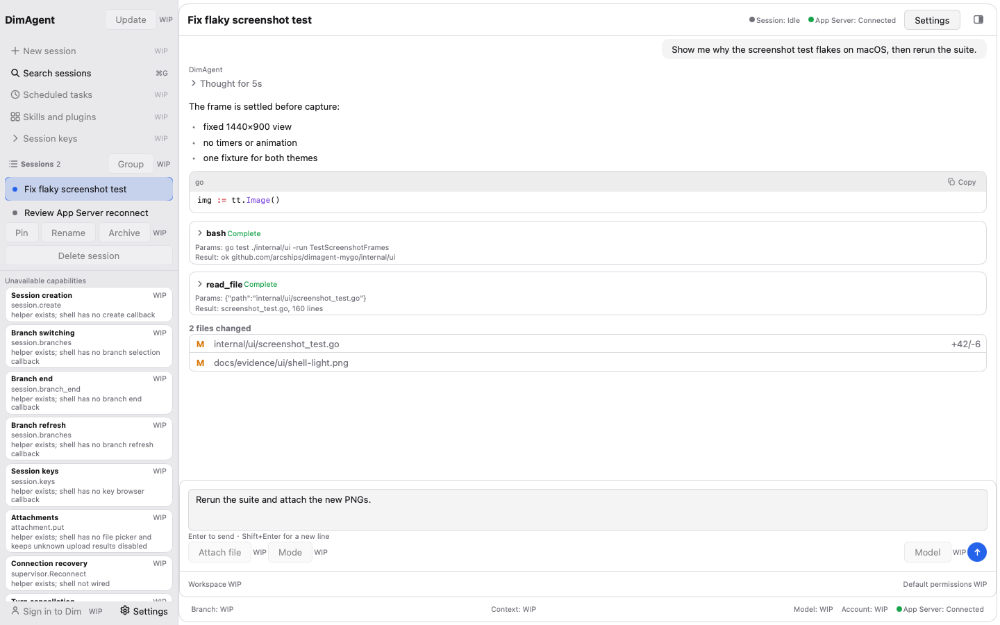
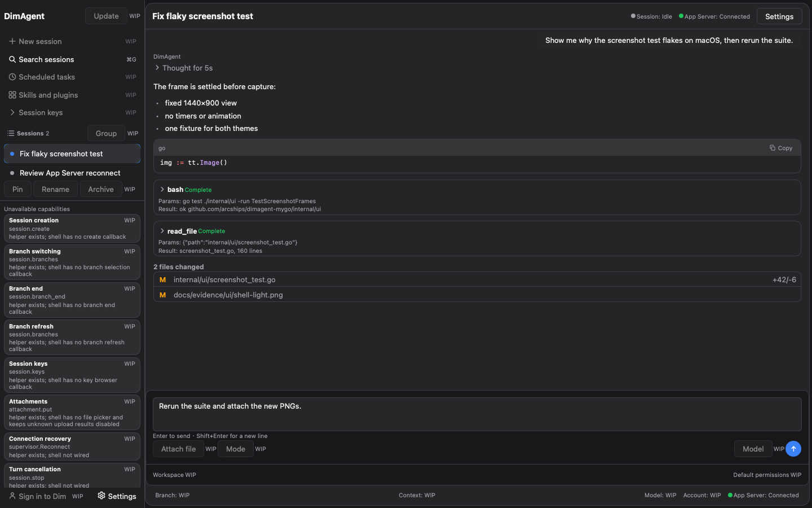

# UI 截图证据（headless）

本目录保存 `internal/ui` 静态壳的 headless 截图，用来证明固定 fixture 在 1440×900 下的渲染是稳定的（两主题、非空、尺寸正确、light/dark 像素不同）。生成代码是 [`internal/ui/screenshot_test.go`](../../../internal/ui/screenshot_test.go)。

## 生成命令

从仓库根目录运行：

```bash
DIMAGENT_UI_SCREENSHOT_DIR="$PWD/docs/evidence/ui" go test ./internal/ui -run TestScreenshotFrames -v
```

- 未设置 `DIMAGENT_UI_SCREENSHOT_DIR` 时，测试只做断言，不写任何文件（`go test ./internal/ui` 保持只读）。
- 设置后写入本目录的 `shell-light.png`、`shell-dark.png`（有待审批请求，占用 composer 槽位）和 `shell-light-composer.png`、`shell-dark-composer.png`（无待审批，显示 composer 与草稿），目录不存在会自动创建。
- 截图 API 来自 mygo v0.8.3 模块源码：`ui.NewTester(view, width, height)`、`(*Tester).SetDark(bool)`、`(*Tester).Image() *image.RGBA`。mygo 自带的 `MYGO_UI_PNG` 只服务于该模块自己的 `ui/ui_test.go`，不是公开 API，本项目不读取它。

## 产物

| 文件 | 主题 | 状态 | 尺寸 | 大小 |
|---|---|---|---|---|
| [`shell-light.png`](shell-light.png) | Light | 待审批（composer 槽位） | 1440×900 | 155,759 B |
| [`shell-dark.png`](shell-dark.png) | Dark | 待审批（composer 槽位） | 1440×900 | 158,243 B |
| [`shell-light-composer.png`](shell-light-composer.png) | Light | composer + 草稿 | 1440×900 | 157,433 B |
| [`shell-dark-composer.png`](shell-dark-composer.png) | Dark | composer + 草稿 | 1440×900 | 159,977 B |






文件大小随字体栅格化和压缩实现变化，不作为断言；测试断言的是尺寸、非空和两主题像素不同。

## 侧栏布局（P0，规格见 [`docs/ui-layout-spec.md`](../../ui-layout-spec.md) §2）

截图里的侧栏按 256 DIP 默认宽绘制，左侧内容与主区之间是可拖的分隔条（MyGo `ui.Split`，`internal/ui/shell.go` 的 `View`）：

| 区域 | 高度 / 宽度 | 数值来源 |
|---|---|---|
| 侧栏宽 | 256（拖拽 200–360） | `docs/ui-layout-spec.md` §1.2；`internal/ui/tokens.go` |
| Header | 48，上边距 4，左右内距 7 | `h-(--titlebar-height)=48px`、`mt-[4px]`、`px-2` |
| 全局入口 | 每条 28 高，间距 3.5，区块内距 7 | `h-8`、`gap-1`、`p-2` |
| 表标题行 | 31.5 高，左右内距 7 | `h-9`、`px-3` |
| 线程行 | 34 高，圆角 8 | `h-[34px]`、`rounded-md`（分组视图） |
| 行内状态格 | 21×21 | `h-6 w-6` |
| 底部署名行（Pin/Rename/Archive） | 最小 30 高 | `h-[30px]`（footer 行高） |

这些 Tailwind 档位都按规格换算成 14px 根字号下的 DIP，而不是照抄 4px 网格。侧栏本身是唯一滚动区（`ui.List`），底部的只读 capability cards 在窗口高度不够时在自己的区域滚动。截图里的两个 session 都没有 `Group` 标签，所以线程列表保持 flat；分组标题、选中态和 hover 态由 [`internal/ui/sidebar_test.go`](../../../internal/ui/sidebar_test.go) 的 headless 断言覆盖。

## 时间线行（P0，规格见 [`docs/ui-layout-spec.md`](../../ui-layout-spec.md) §4）

截图里的会话按行模型渲染：一行一个 `turn`，turn 内部再按 block 分派。档位同样按 14px 根字号换算成 DIP，全部来自 `internal/ui/tokens.go` 的 `timeline*` 字段：

| 区域 | 高度 / 内距 / 圆角 | 数值来源 |
|---|---|---|
| 行外壳 | 左右 14（`px-4`）；上下沿用壳层行距 4（`rowPadY`，§4.2 没有对应内距） | §4.2；`timelinePadX` |
| block 间距 | 10.5（`mb-3`） | `timelineBlockGap` |
| 折叠头 | 最小 24.5 高（`h-7`，字号更大时随内容长高），箭头 14（`h-4`） | `timelineHeaderH`、`timelineChevron` |
| thinking 正文 | 左缩进 10.5（`pl-3`），左侧 2px 导轨，上限 240（`max-h-[240px]`） | `timelinePadStart`、`timelineRail`、`timelinePanelMaxH` |
| tool 展开面板 | 上限 240，圆角 8，1px 描边 | §4.2；`timelinePanelMaxH` |
| 用户气泡 | 最宽 85%（`max-w-[85%]`），内距 7/14（`py-2 px-4`），圆角 10（`rounded-lg`），右对齐 | `timelineUser*`、`timelineBubbleR` |
| 文件改动行 | 上下 5.25、左右 7（`py-1.5 px-2`），状态字母格 17.5（`w-5`），行距 10.5（`gap-3`） | `timelineFile*` |

行模型的四个 block 类型（`internal/ui/timeline.go`）：`BlockText`（Markdown）、`BlockThinking`（默认折叠，头文本 `Thinking` / `Thought for Ns`）、`BlockTool`（可展开卡片）、`BlockFileChanges`（紧凑行，无折叠）。错误与重试是独立行类型（`AuthorError` / `AuthorRetry`），不是 block。

折叠状态是 shell 自己的视图状态（`State.expandedBlocks`），按「行 ID + block ID」存在内存里；daemon 不拥有「用户是否展开过」，所以它也不会被当作会话事实。

## Fixture 内容

固定 fixture 是手填的视图状态，不连 App Server，不读 SQLite/JSONL/session 文件/daemon.log：

- 两个 session：`Fix flaky screenshot test`（选中）、`Review App Server reconnect`，`Group` 为空（shell 没有 project/日期来源，不伪造分组）。
- 侧栏的 WIP 入口：`Update`、`Search sessions`（⌘G / Ctrl+G 提示）、`Group`、`Pin`/`Rename`/`Archive`；它们都带 `WIP` 标记和真实原因，点击不产生动作。
- 会话内容：
  - user：右对齐 85% 气泡；
  - assistant：一个 turn，内部按顺序是 thinking（`Thought for 5s`，默认折叠）、Markdown 文本（列表 + Go fenced code block）、两个 tool 卡片（`bash`、`read_file`，均 `Complete`）、file changes（`2 files changed`，两行文件）；
  - 待审批状态（`shell-{light,dark}.png`）：`exec` 请求带 `BranchID`/`RequestID`，占用 composer 槽位渲染 `Approval required` 面板和真实 `Approve`/`Deny`（fixture 回调为空实现，不发请求）。
- composer 状态（`shell-{light,dark}-composer.png`）：无待审批，显示草稿 `Rerun the suite and attach the new PNGs.`、提示行 `Enter to send · Shift+Enter for a new line`、底部 `Attach file`/`Mode`/`Model`（WIP）与 `Send`。
- `Connection: ConnReady`、`Run: RunIdle`，让状态行和 Send 按钮处于正常态。

**数据来源缺口**：file changes 在 projection 里还没有对应事实（`internal/projection` 不折叠任何 file-changes 事件），`ui.Block.Files` 目前只由 fixture 填充，adapter 不伪造。截图证明的是渲染形态，不是 daemon 已上报文件改动。tool 卡的类型化面板（command/file/search）同样还是 P0 WIP，现在只有一种通用 Params/Result 面板。

## 测试断言

`TestScreenshotFrames` 对四个 frame（approval/composer × light/dark）分别检查：

1. `Image()` 非 nil，尺寸严格为 1440×900；
2. 画面不止一种颜色（非空白帧）；
3. 同一状态的 light 与 dark 像素缓冲不同；
4. approval 状态与 composer 状态在同一主题下像素不同。

只有设置了 `DIMAGENT_UI_SCREENSHOT_DIR` 才额外编码 PNG。

时间线的行为断言（thinking 折叠/展开、tool 展开、file changes 紧凑行、多 block 顺序、Tab/Space/Enter 可达性）在 [`internal/ui/timeline_test.go`](../../../internal/ui/timeline_test.go)；截图只负责「同一 commit 前后看起来没坏」。

## 证据边界

**截图只证明 headless 渲染稳定，不等于与 Electron 端 1:1。** 它不覆盖真实窗口合成、字体/DPI 差异、系统外观跟随、动效、IME、VoiceOver 或 Windows/Linux 运行时；token 语义层与 Electron 的差距见 [`docs/ui-parity.md`](../../ui-parity.md)。这些 PNG 是渲染回归证据，不是产品验收证据。
